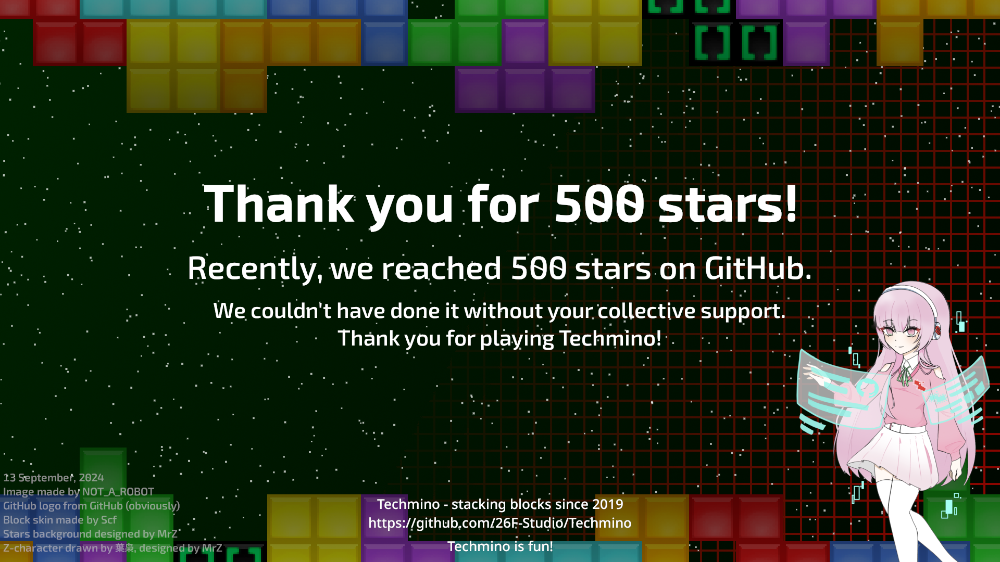

# Techmino

***[GitHub](https://github.com/26F-Studio/Techmino)  [Gitee](https://gitee.com/f26-studio/Techmino)***

《Techmino: 方块研究所》 官方仓库 (26F-Studio/Techmino)

The Official Repository of Techmino (26F-Studio/Techmino)

集合各种现代方块规则，更多玩法，全新体验。

A collection of various modern block game rules, more ways to play, and some new things added for a new experience.

## Download the latest version (最新版下载)

| Android | Linux | Windows x86 | Windows x64 | macOS .dmg | macOS .pkg | App Store & TestFlight (iOS) |
| --- | --- | --- | --- | --- | --- | --- |
| [普通下载 (Direct download)](https://github.com/26F-Studio/Techmino/releases/latest/download/Techmino_Android.apk) | [普通下载 (Direct download)](https://github.com/26F-Studio/Techmino/releases/latest/download/Techmino_Linux.AppImage) | [普通下载 (Direct download)](https://github.com/26F-Studio/Techmino/releases/latest/download/Techmino_Windows_x86.zip) | [普通下载 (Direct download)](https://github.com/26F-Studio/Techmino/releases/latest/download/Techmino_Windows_x64.zip) | [普通下载 (Direct download)](https://github.com/26F-Studio/Techmino/releases/latest/download/Techmino_macOS_portable.dmg) | [普通下载 (Direct download)](https://github.com/26F-Studio/Techmino/releases/latest/download/Techmino_macOS_portable.pkg) | [App Store](https://apps.apple.com/app/1590869403)        |
| [加速下载 (Mirror download)](https://ghproxy.com/https://github.com/26F-Studio/Techmino/releases/latest/download/Techmino_Android.apk) | [加速下载 (Mirror download)](https://ghproxy.com/https://github.com/26F-Studio/Techmino/releases/latest/download/Techmino_Linux.AppImage) | [加速下载 (Mirror download)](https://ghproxy.com/https://github.com/26F-Studio/Techmino/releases/latest/download/Techmino_Windows_x86.zip) | [加速下载 (Mirror download)](https://ghproxy.com/https://github.com/26F-Studio/Techmino/releases/latest/download/Techmino_Windows_x64.zip) | [加速下载 (Mirror download)](https://ghproxy.com/https://github.com/26F-Studio/Techmino/releases/latest/download/Techmino_macOS_portable.dmg) | [加速下载 (Mirror download)](https://ghproxy.com/https://github.com/26F-Studio/Techmino/releases/latest/download/Techmino_macOS_portable.pkg) | [TestFlight](https://testflight.apple.com/join/SZOFUqFv) |

-----

[官网(重构中) Official Website (RWIP)](https://www.studio26f.org/home)

[社区引导站(建设中)(非官方) Techmino Hub (WIP)(unofficial)](https://techmino-hub.vercel.app/)

[Github维基(暂停建设) Github Wiki (WNIP)](https://github.com/26F-Studio/Techmino/wiki)

## Paypal Donation (Paypal赞助)

开了一个支付方式试一下，记得自己留一下付款记录，未来可能会返一些东西（不保证）

Made a payment method to try it out, remember to keep a payment record, there may be some benifits in the future (not guaranteed)

## 500 Stars Poster

## Online services

Online play uses the independent Tessera account service and Cadence game service. See the [deployment guide](../../WebstormProjects/Tessera/deploy/README.md) and [client transport/package guide](../Cadence/transport/README.md). Configure exact HTTPS public origins before packaging; no account password or resource-server secret belongs in the game.

Sign-in is user-triggered and uses the system browser for account login, verification and consent. Native product sessions use OS-protected refresh storage, or visibly remain memory-only when the store is unavailable or locked. Web sessions use an independent HttpOnly product cookie; access credentials remain in memory. Ordinary website sign-out does not revoke the game's grant. The account page can revoke a device, withdraw a product or sign out all devices.

Rooms offer complete default `netBattle` / TRS server authority and a separately labeled casual relay. Relay results are unverified; unsupported authoritative modes are not enabled. Player tuning and participants freeze at start. Hosts can select automatic disconnect/temporary-absence pause, a 5/10/30-second single-pause ceiling and a sixty-second total pause budget. Recovery lasts at most ten seconds; leaving, kick and authorization withdrawal are terminal.

The primary board follows the signed-in participant in both online tracks,
without reordering the server's frozen roster or slot-to-input mapping.
Spectators retain the source-order layout. Initial placement and later layout
updates share the same positioning path.

Run `python3 .github/tests/online_layout.py` to exercise the actual LÖVE client
with isolated saves: either two-player perspective, the last slot in a full
room, relay elimination/repositioning, and spectator layout.
CI runs this regression with LÖVE 11.5 and requires its success marker. Runtime
downloads follow release redirects and reject HTTP errors before execution.

Cloud save versions contain bounded strict JSON, not executable Lua or credentials. At most five versions are retained. A concurrent update requires an explicit conflict choice; restore first backs up local data. Uploaded offline statistics are not authoritative ranking evidence. Offline play, local saves and local replays remain owned by the original game.

Linux AppImage packaging preserves the game's bundled libraries while restoring the host library/search environment only for the external system-browser opener. Local original AppImage consent, WSS `ready`, room directory and device logout passed after that packaging fix. Matching Debian installation and its installed LÖVE launcher were exercised separately; this is not Debian GUI/online, all-platform or production acceptance. See the package guide for the actual evidence boundaries and unlocked Secret Service prerequisite.

### Local validation CI

The `ci-local-online-validation-20261020` branch packages the account/website
origin `https://localhost:17445` and the separate game origin
`https://127.0.0.1:17446`. These overrides apply only to that exact CI branch;
other branches and releases still require their configured public origins.
Both services must run on the same computer as the client. These packages do
not make a workstation's loopback services reachable from a phone or another PC.

Trust the local fixture CA in the browser. Native desktop clients can add the
same CA through `TECHMINO_TRANSPORT_CA_FILE=/absolute/path/to/ca.pem`; hostname
verification remains enabled. Never distribute the CA private key or disable
certificate validation. An existing saved `conf/online.json` takes precedence
over package endpoints. The vendored CI source contains only the standalone
transport crate, its lockfile, and its platform bridges, not the game backend.

Validation branches upload CI artifacts without publishing GitHub Pages.
Pages deployment remains limited to `main` and release tags. Windows, Linux,
Android and Web builds run for this validation branch; macOS and iOS retain
their release-tag signing/distribution requirements and are not triggered here.
Android packaging runs pinned `cargo-ndk` from the resolved transport crate,
not the non-Rust client root, so its initial Cargo metadata lookup succeeds.

### Galaxim boundary and feasible directions

The existing `net_galaxim` entry remains visible. Its match action already reports the game's unfinished-feature notice; this rewrite does not claim a Galaxim game or silently route that action into `netBattle`.

- A social/discovery hub can reuse trusted product identity, bounded room commands and revisioned membership without introducing a simulation or authoritative ranking. The world/map state, persistence and interaction rules still need an explicit product design.
- A cooperative or competitive Galaxim mode requires a concrete gameplay specification, its own allowlisted ruleset and deterministic state/input contract. Reuse admission, ownership, pause, settlement and replay boundaries, but do not treat the existing default `netBattle` engine as proof for another mode.
- A launch link into Techmino Galaxy can use the distinct registered `techminoGalaxy` product authorization. Galaxy's current account integration does not imply multiplayer ZTC modes or a completed shared-world protocol.

Choose the gameplay direction before enabling the existing match control. Existing account, room and transport infrastructure does not by itself define the missing game.
